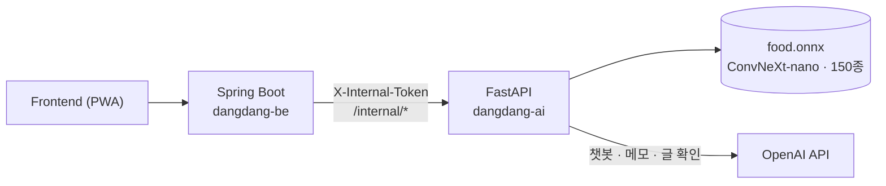

<div align="center">


# 당당 AI

**사진 · 질문 · 진료 메모를 읽고 정리해 주는<br/>당당의 내부 AI 서버예요**

[](https://dang-dang.site)
[](https://github.com/dangdang-2026/dangdang-ai/actions)

[한눈에 보기](#-한눈에-보기) · [구조](#️-구조) · [API](#-api) · [모델](#-음식-사진-모델) · [실행하기](#-로컬에서-실행하기) · [배포](#-배포)

</div>

<br/>

## 📌 한눈에 보기

| 영역 | 이렇게 도와요 |
|---|---|
| 📸 **음식 사진** | 한식 150종을 배운 모델이<br/>음식 이름 후보 3개와 확신도를 돌려줘요. |
| 💬 **당당이 챗봇** | 질문을 읽고 무엇을 보여 줄지 골라요.<br/>숫자 계산은 Spring이 해요. |
| 📝 **진료 메모 정리** | 메모를 다음 진료 · 검사 · 약 · 기타로 나누고<br/>칸마다 근거 문장을 그대로 붙여요. |
| 🛡️ **글 올리기 전 확인** | 약 용량 · 위급한 몸 상태 · 마음 위기<br/>문장을 찾아 알려 줘요. |

> [!IMPORTANT]
> AI는 **기록만 도와요.** 혈당이 괜찮은지 판정하거나 권고하지 않아요.
> Spring 백엔드만 내부 토큰으로 부르고, 브라우저에는 열지 않아요.

<br/>

## 🏗️ 구조



| 원칙 | 어떻게 |
|---|---|
| **판독만** | 사용자 문구 · 응답 형식 · 동의 · 하루 횟수는<br/>Spring이 맡아요 |
| **확신도 기준 0.7** | 1등이 0.7보다 낮으면 Spring이 「이름으로 적기」로 보내요 |
| **키가 없어도 켜져요** | 모델 파일이 없으면 사진 주소만 503<br/>LLM 키가 없으면 챗봇 · 메모 정리만 503 (글 확인은 규칙으로) |
| **저장하지 않아요** | 사진 · 메모 내용은 메모리에서만 처리해요<br/>로그엔 찾은 칸 이름만 남겨요 |

<br/>

## 🧩 API

| 주소 | 하는 일 |
|---|---|
| `GET /health` | 서버 상태 (Docker HEALTHCHECK) |
| `POST /internal/food-candidates` | 사진 1장 (10MB까지) → 음식 후보 3개 · 확신도 |
| `POST /internal/chat` | 질문 → 무엇을 보여 줄지<br/>`RECORDS` · `QUESTION_DRAFT` · `INFO` · `UNKNOWN` |
| `POST /internal/visit-note/organize` | 진료 메모 + 진료한 날 → 칸별 정리 · 근거 문장 |
| `POST /internal/post-check` | 글 제목 · 내용 → 걸리는 문장<br/>`DOSE` · `URGENT_MEDICAL` · `MIND` |

`/internal/*`는 모두 `X-Internal-Token` 헤더가 맞아야 해요 (없거나 틀리면 401).

<details>
<summary><b>음식 후보 응답 예시 · 에러 코드</b></summary>

```json
{
  "candidates": [
    { "name": "김치볶음밥", "confidence": 0.8612 },
    { "name": "비빔밥", "confidence": 0.0421 },
    { "name": "볶음밥", "confidence": 0.0198 }
  ]
}
```

| HTTP | 언제 |
|---|---|
| 400 | 사진으로 열 수 없는 파일 (HEIC는 JPEG로 바꿔서) |
| 401 | `X-Internal-Token`이 없거나 틀림 |
| 413 | 사진이 10MB 초과 |
| 503 | 모델 파일 · LLM 키가 없음 |

</details>

<br/>

## 📸 음식 사진 모델

| 항목 | 지금 (2026-11-14~) |
|---|---|
| 모델 | [`convnext_nano.in12k_ft_in1k`](https://huggingface.co/timm/convnext_nano.in12k_ft_in1k) (Hugging Face · Apache-2.0)를 150종으로 다시 학습 |
| 학습 데이터 | AI Hub 「한국 이미지(음식)」 150종 × 300장 |
| val Top-1 / Top-3 | **82.2% / 93.8%** |
| 실제 사진 156장 | **75.2% / 91.2%** (내 사진 57장 + 위키미디어 CC 99장) |
| 서버용 파일 · 속도 | ONNX 60MB · CPU에서 사진 1장 약 0.1초 |

**어떻게 좋아졌나** — 같은 실제 사진 156장으로 시험

| 날짜 | 바꾼 것 | Top-1 / Top-3 |
|---|---|---|
| 11/10 | EfficientNet-B0, 판단 층만 학습 | 49.6% / 69.6% |
| 11/11 | 끝 3묶음까지 풀어서 이어 학습 | 68.0% / 84.0% |
| 11/14 | ConvNeXt-nano로 교체 | **75.2% / 91.2%** |

학습 방법과 전체 실험 기록은 [`training/README.md`](training/README.md)에 있어요.

<br/>

## 🤖 글 AI

| 기능 | 모델 | 지키는 규칙 |
|---|---|---|
| 챗봇 | `LLM_MODEL` (기본 `gpt-5.4-nano`) | 일반 정보는 원문을 확인한 승인 자료만 (`sources.py`)<br/>맞는 자료가 없으면 「병원에 물어보세요」 |
| 진료 메모 정리 | `LLM_MODEL_NOTE` (기본 `gpt-5.4-mini`) | 근거 문장이 메모에 정말 있는지 다시 확인 (`verify.py`) |
| 글 확인 | 규칙 + `LLM_MODEL` | 규칙으로 먼저 찾고, 약 · 용량 문장만 GPT로 한 번 더 |

평가 문장과 채점 스크립트는 [`evals/`](evals/README.md)에 있어요.

```bash
uv run python -m evals.run_chat        # 챗봇 답 종류
uv run python -m evals.run_visit_note  # 진료 메모 정리
uv run python -m evals.run_post_check  # 글 확인
```

<br/>

## 🛠️ Tech Stack

| 분류 | 사용 기술 |
|---|---|
| Language · Server | Python 3.11 · FastAPI · Uvicorn · pydantic-settings |
| 사진 추론 | ONNX Runtime · Pillow · NumPy |
| 글 AI | OpenAI Python SDK |
| 학습 (서버 이미지 제외) | PyTorch · torchvision · timm · ONNX |
| 검사 | pytest · Ruff · `evals/` |
| Build · Infra | uv · Docker · Docker Hub · GitHub Actions |

<br/>

## 📁 폴더 구조

<details>
<summary><b>펼쳐 보기</b></summary>

```text
app/
├── main.py              # FastAPI 앱 · /health · 켤 때 모델 불러오기
├── core/                # config.py 환경변수 · llm.py OpenAI 클라이언트
├── food/                # /internal/food-candidates — router · preprocess · predictor
├── chat/                # /internal/chat — router · brain · prompt · sources(승인 자료)
├── visit_note/          # /internal/visit-note/organize — router · organize · verify
└── moderation/          # /internal/post-check — router · rules · dose_check
training/                # 모델 학습 · ONNX 변환 · 내 사진 시험 (서버와 따로)
evals/                   # 기능별 평가 문장 · 채점 · 결과
tests/                   # pytest
models/                  # food.onnx · labels.json (깃 제외, 서버에만)
docker/Dockerfile        # 비root · KST · HEALTHCHECK
```

</details>

<br/>

## 💻 로컬에서 실행하기

**필요한 것** — [uv](https://docs.astral.sh/uv/) (Python 3.11은 uv가 준비해요)

```bash
git clone https://github.com/dangdang-2026/dangdang-ai.git
cd dangdang-ai && git switch develop

uv sync                  # 의존성 설치
cp .env.example .env     # INTERNAL_TOKEN · LLM_API_KEY 채우기 (커밋 금지)
uv run uvicorn app.main:app --reload
```

| 확인할 곳 | 주소 |
|---|---|
| API 문서 | http://localhost:8000/docs |
| Health Check | http://localhost:8000/health |

- 모델 파일(`models/food.onnx` · `labels.json`)은 깃에 없어요. 없으면 사진 주소만 503이에요.

```bash
uv run ruff check . && uv run ruff format --check .
uv run pytest
```

<br/>

## 🔐 환경변수

견본은 [`.env.example`](.env.example)에 있어요.<br/>
운영 값은 dangdang-be의 GitHub Secrets(`ENV_PROD` · `ENV_DEV`) → 서버 `.env`에만 둬요.

| 변수 | 쓰임 |
|---|---|
| `INTERNAL_TOKEN` | Spring → AI 호출 확인 (Spring과 같은 값) |
| `LLM_API_KEY` | OpenAI API 키 |
| `LLM_MODEL` | 챗봇 · 글 확인 모델 (기본 `gpt-5.4-nano`) |
| `LLM_MODEL_NOTE` | 진료 메모 정리 모델 (기본 `gpt-5.4-mini`) |
| `FOOD_MODEL_PATH` | 모델 파일 (기본 `models/food.onnx`) |
| `FOOD_LABELS_PATH` | 음식 이름표 (기본 `models/labels.json`) |
| `AIHUB_APIKEY` | 학습 데이터 받을 때만 (서버엔 필요 없음) |

<br/>

## 🚀 배포

| 단계 | 하는 일 |
|---|---|
| **CI** | `develop` · `main`에 Push · PR이 생기면 `ruff` · `pytest` |
| **CD** | `main`에 Push되면 이미지를 Docker Hub에 올려요 (`latest` · 커밋 sha) |
| **운영** | dangdang-be compose의 `ai` 서비스 · Spring만 `http://ai:8000`으로 불러요 (메모리 1GiB) |
| **모델 파일** | 깃 · 이미지에 넣지 않고 서버 `~/dangdang/ai-models/`에 둬요<br/>바꿀 땐 파일만 교체하고 `restart ai` |

```bash
# 모델만 바꿀 때 (맥에서)
scp models/food.onnx models/labels.json dangdang-kt:~/dangdang/ai-models/
ssh dangdang-kt 'cd ~/dangdang/docker && docker compose restart ai'

# 새 이미지로 바꿀 때 (main 머지 → CD 초록 뒤)
ssh dangdang-kt 'cd ~/dangdang/docker && docker compose pull ai && docker compose up -d ai'
```

<br/>

## 📚 데이터 출처

- 음식 사진 모델은 과학기술정보통신부 · 한국지능정보사회진흥원의 [AI 허브](https://aihub.or.kr) 「한국 이미지(음식)」로 학습했어요.
- AI 허브 데이터는 반출 · 재배포가 금지라서, 학습은 로컬에서만 하고 사진은 올리지 않아요.
- 챗봇 일반 정보는 학회 · 공공기관 환자용 자료에서 원문을 확인한 문장만 써요.

<br/>

## 👥 Team

|  |  |
|:---:|:---:|
| **김승민** · [@seungminng123](https://github.com/seungminng123) | **임다현** · [@dahyun0423](https://github.com/dahyun0423) |
| Frontend · Backend | PM · AI · Infra |

<div align="center">

<br/>

[Frontend](https://github.com/dangdang-2026/dangdang-fe) · [Backend](https://github.com/dangdang-2026/dangdang-be) · **AI** · [Organization](https://github.com/dangdang-2026)

</div>
